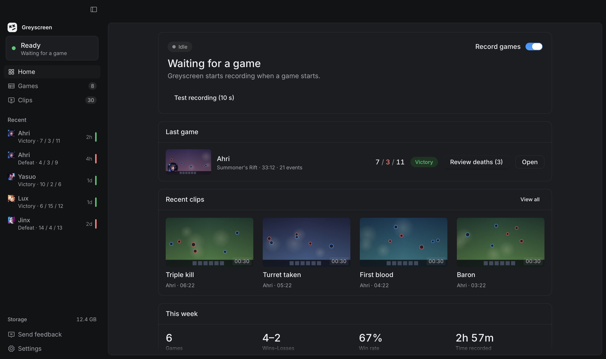
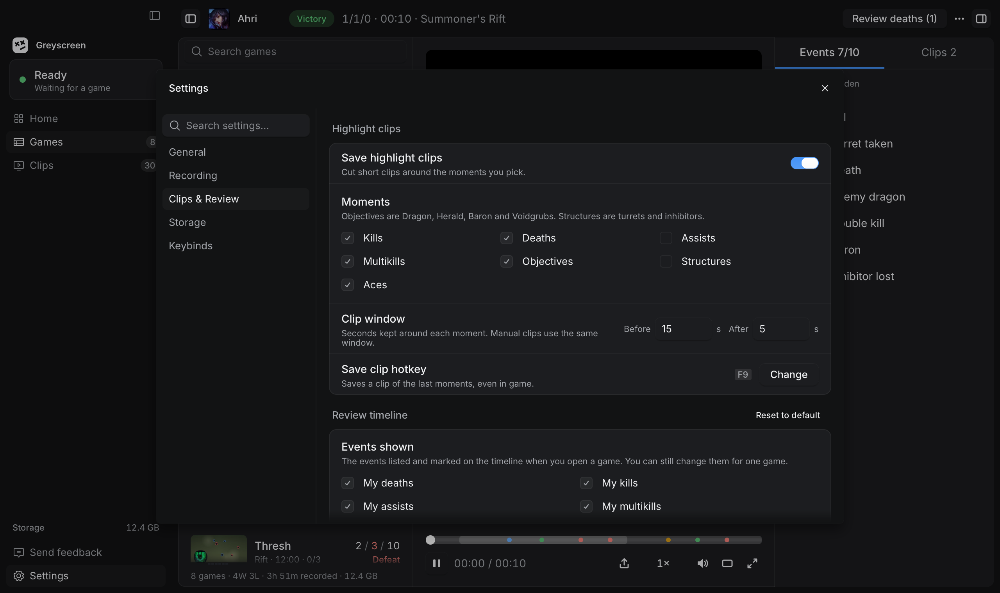
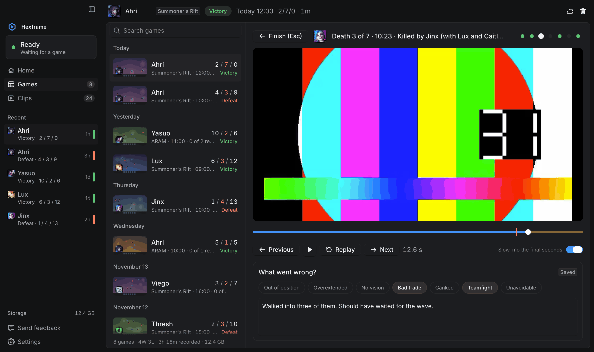
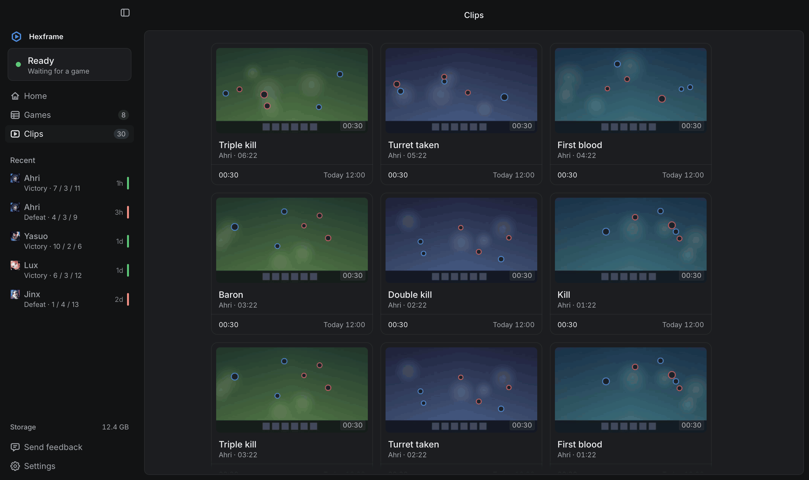
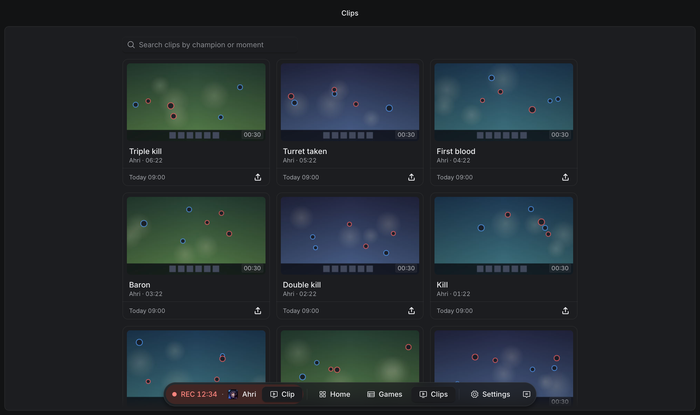

<p align="center">
  <picture>
    <source media="(prefers-color-scheme: dark)" srcset="brand/logo-horizontal-dark.svg">
    <source media="(prefers-color-scheme: light)" srcset="brand/logo-horizontal-light.svg">
    
  </picture>
</p>

<p align="center"><b>The fastest League of Legends recorder for Windows.</b><br>Free, open source, no ads, no account.</p>

<p align="center">
  <a href="https://github.com/andresmarpz/greyscreen/releases"></a>
  <a href="LICENSE"></a>
  
</p>

<p align="center">
  <a href="https://greyscreen.app">Website</a> ·
  <a href="https://greyscreen.app/download/">Download</a> ·
  <a href="https://greyscreen.app/changelog/">Changelog</a>
</p>

<p align="center">
  
</p>

<table>
  <tr>
    <td width="50%"><br><sub><b>Settings.</b> Pick which moments become clips.</sub></td>
    <td width="50%"><br><sub><b>Death review.</b> See why you die and when.</sub></td>
  </tr>
  <tr>
    <td width="50%"><br><sub><b>Clips.</b> Every highlight, ready to share.</sub></td>
    <td width="50%"><br><sub><b>Dock.</b> Prefer a bottom bar? Switch the navigation in Settings.</sub></td>
  </tr>
</table>

## Features

- **Fast.** Near-zero FPS cost while you play.
- **Records every game on its own.** It starts when the game loads and stops after the Nexus falls.
- **Marks every death.** Kills, deaths and objectives sit on a timeline. Click one to jump there.
- **Death review.** Step through each death in slow motion, tag the cause and add a note.
- **Clips.** Highlights are cut for you. Press `F9` to save the last seconds.
- **Crash-safe files.** Recordings are repaired after a crash.
- **Tiny tray app.** One small exe with no extra runtime.
- **No admin rights.** It installs to your user folder and updates itself.

## Install

Download `GreyscreenSetup.exe` from the [latest release](https://github.com/andresmarpz/greyscreen/releases) and run it. It installs Greyscreen to `%LOCALAPPDATA%\Programs\Greyscreen` and adds a Start Menu shortcut, with an option to start with Windows. To remove it, use Windows Settings > Apps. Your recordings and settings stay.

Requirements:

- Windows 10 2004 or newer (Windows 11 recommended).
- A GPU with a hardware H.264 encoder (most NVIDIA, AMD and Intel GPUs from the last several years). Without one, Greyscreen records with Windows' software encoder at up to 1080p 30 fps, which uses more CPU.
- League of Legends in **Borderless** or **Windowed** mode. Exclusive fullscreen cannot be captured.

On Windows 10 a thin yellow border may appear around the game while recording. This is a Windows limitation.

## Usage

Start Greyscreen and play. Recording begins when the game finishes loading and stops a few seconds after the Nexus falls. TFT, replays and spectator games are not recorded.

Each match is saved to `Videos\Greyscreen\<date>_<champion>_<mode>\`:

- `game.mp4`: the full match recording.
- `game.json`: the match event timeline.
- `clips\`: highlight clips.

**Games** lists every match. **Review deaths** (`D`) steps through each death. **Clips** shows your highlights. **Home** shows the current state, and **Test recording (10 s)** checks capture before a match.

Settings (the gear in the sidebar, or `Ctrl+,`) cover quality (`Balanced`, `High`, `Max`), resolution, frame rate (`30` or `60` fps), audio, clips, the output folder, a storage limit, keybinds and the navigation style (sidebar or dock).

- Settings file: `%APPDATA%\Greyscreen\settings.json`
- Logs folder: `%LOCALAPPDATA%\Greyscreen\logs`

<details>
<summary><b>Troubleshooting</b></summary>

<br>

Black video usually means the game is in exclusive fullscreen, or you are on a laptop with two GPUs. Switch League to Borderless or Windowed mode, and set Greyscreen to **High performance** in Windows Graphics settings.

Use `greyscreen-cli.exe` from a terminal to diagnose capture or encoding issues:

```powershell
# Print GPU info, available hardware encoders, and capture/encoder test results
greyscreen-cli.exe doctor

# Record 10 seconds of the primary monitor
greyscreen-cli.exe record --seconds 10

# Record 10 seconds of a specific window
greyscreen-cli.exe record --seconds 10 --window "<title>"

# Repair an unfinalized recording after a crash
greyscreen-cli.exe recover <file.mp4.part>
```

When you report a problem, attach the contents of `%LOCALAPPDATA%\Greyscreen\logs`.

</details>

## How it works

Video frames stay on the GPU from capture to encode. Audio comes only from the League process. Match state comes from Riot's local Live Client Data API. The fragmented MP4 writer is pure Rust.

```text
Game window -> Windows.Graphics.Capture (D3D11)
                 -> ID3D11VideoProcessor (BGRA -> NV12, BT.709)
                   -> Hardware H.264 MFT -> Packet ring --+
                                                          +-> Fragmented MP4 writer
Game audio  -> WASAPI process loopback -> AAC MFT --------+

Live Client Data API (127.0.0.1:2999)
  -> Session state machine -> Start/stop, event timeline, highlight clips
```

<details>
<summary><b>Building from source</b></summary>

<br>

Greyscreen is developed on macOS and cross-compiled to Windows with `cargo-xwin`. It also builds natively on Windows with the MSVC toolchain.

Requirements:

- Rust (the toolchain is pinned in `rust-toolchain.toml`)
- `just`
- On macOS: `cargo-xwin` and Homebrew LLVM

```bash
# macOS setup
brew install just llvm typos-cli
cargo install --locked cargo-xwin

# Everyday gate: format check and clippy
just check

# Tests matching a filter
just test mp4

# Windows release executables
just build-win

# Simulate a League match, then run the UI against it with fake capture
cargo run -p greyscreen-cli -- fake-league --port 2999 --speed 4
GREYSCREEN_LIVE_URL=http://127.0.0.1:2999 cargo run -p greyscreen
```

</details>

<details>
<summary><b>Project layout</b></summary>

<br>

| Path | Description |
| --- | --- |
| `crates/app` | The Rune UI binary. |
| `crates/cli` | The `doctor`, `record`, `recover`, `fake-league`, `thumb`, `storyboard` and `demo` CLI tool. |
| `crates/core` | Settings, events, the session state machine, and clip logic. |
| `crates/engine` | The recording engine. |
| `crates/capture` | Windows capture and hardware encoding. |
| `crates/mp4` | Pure Rust fragmented MP4 writer. |
| `crates/thumbs` | JPEG thumbnails from MP4 frames through the OS decoder. |
| `crates/league` | Live Client Data API client, plus the update and feedback clients. |
| `apps/web` | The website. |
| `apps/api` | The feedback backend on Cloudflare. |

Design notes live in [docs/architecture.md](docs/architecture.md), [docs/roadmap.md](docs/roadmap.md) and [docs/research/](docs/research/).

</details>

## License

Copyright (c) 2026 andresmarpz. GNU Affero General Public License, version 3 or later (AGPL-3.0-or-later). See [LICENSE](LICENSE). Releases up to and including `0.1.19-preview.21` were published under the MIT license and stay under it.

Parts that keep their own license:

- The sound effects in `crates/app/assets/sounds` come from [Hex](https://github.com/anomalyco/hex) (MIT, see `LICENSE-hex.txt` there).

## Legal

Greyscreen isn't endorsed by Riot Games and doesn't reflect the views or opinions of Riot Games or anyone officially involved in producing or managing Riot Games properties. Riot Games, and all associated properties are trademarks or registered trademarks of Riot Games, Inc.
